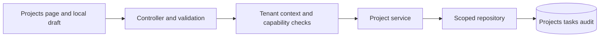

# Worked design: Design tenant-safe project writes and predictable list reads

## Start with a bounded user journey

A member lists projects for an authorized organization, opens a draft, saves against an expected version, and receives either the updated record or an explicit conflict while the draft remains recoverable.

The invariant is: **Every read and write is restricted to trusted tenant scope, and a stale expected version cannot silently replace a newer accepted project change.**

Non-goals: Do not require one database per tenant, a microservice for every entity, or a new authorization engine before the current membership and repository boundaries are understood.

Before choosing infrastructure, write three acceptance examples: an ordinary successful operation, a repeated or conflicting operation, and an unavailable dependency. Define what the user can still do in each case. A phrase such as highly available is incomplete until you name the operation and the behavior allowed when a dependency fails.

## Worked target architecture

This is the teaching design to evaluate, not a deployment inventory. [Source observations](README.md) distinguish what is present from what is proposed.

Begin with the existing vertical path rather than replacing it with a generic SaaS diagram. Tenant context resolves the organization the caller is allowed to act in; the service checks the operation's capability; the repository still includes scope in its query. These are complementary responsibilities. A correct membership lookup does not repair an unscoped repository query.

The current versioned update already demonstrates a useful conditional-write boundary. Explain why the comparison belongs in the update predicate and why a separate read followed by an unconditional write would race. The audit belongs to the same transaction so an accepted update and its audit do not disagree after a failure.

For list reads, the inspected code obtains items and total in one repeatable-read transaction. That provides a particular within-request read contract; it does not freeze the dataset across several page requests. If pagination becomes unstable or expensive at deep offsets, propose a cursor using the complete ordering tuple and explicitly define behavior under intervening changes.

Keep a shared relational database as the initial design unless concrete isolation, operations, or scale constraints require separation. A tenant-oriented partitioning proposal must explain cross-tenant administration, migration, unique-key scope, backups, and noisy-neighbor controls. It is not an automatic improvement over correct predicates and bounded queries.

## Read the diagram as a set of obligations

For each arrow, state the caller, trust context, timeout or transaction boundary, and observable outcome. Label a database write differently from a notification hint or a local draft update. A line crossing into a worker or provider is a potential failure window; it does not inherit atomicity from an earlier database transaction.

Choose one authoritative record for each decision. Derived caches and UI projections can be rebuilt only if the source of truth and reconstruction policy are clear. A read replica or cached response can be appropriate for some reads while being inappropriate for the admission decision that protects the invariant. Name that distinction before adding either component.

## First implementation slice and later growth

The first proposed slice should support the bounded journey with the existing architecture wherever possible. Include contract validation, authorization, the decisive state transition, a truthful response, and the focused regression that rejects the named failure. If the existing code already meets the behavior, the useful work is characterization and evidence rather than replacement.

Scale in response to a specific bottleneck. More stateless API instances may help request handling while leaving a hot row, connection limit, provider quota, or downstream queue unchanged. A queue can smooth a burst but cannot make sustained arrival exceed processing capacity indefinitely. A cache can reduce eligible reads but adds identity and freshness obligations.

Explain one alternative that could be correct under different requirements. Use the [decision record](05-design-decisions.md) to state the cost of your choice and the observation that would make you reconsider it. The goal is a design another engineer can challenge with a concrete failure, not the largest possible collection of boxes.
